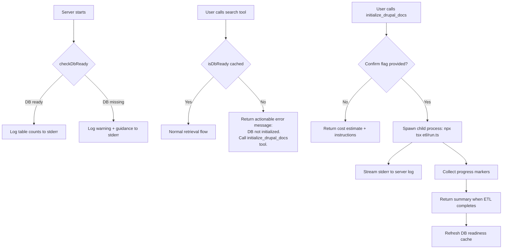

# ETL Trigger from MCP Server

## Goal

When the MCP server starts but no LanceDB database exists, provide clear guidance to the user and an MCP tool to trigger the ETL pipeline — so users never encounter cryptic "table not found" errors.

## Current Status
- [x] Discovery
- [ ] Implementation
- [ ] Validation

## Problem Analysis

### Current failure mode

1. Server starts via `npx tsx src/index.ts` (stdio transport)
2. User calls `ask_drupal_expert`, `search_drupal_docs`, or `deep_research_drupal`
3. `retrieveContext()` in [`retrieval.ts`](src/lib/retrieval.ts:182) calls `vectorSearch()` for each dataset
4. `vectorSearch()` in [`lancedb.ts`](src/lib/lancedb.ts:89) calls `db.openTable(tableName)` which throws
5. The error is caught silently in [`retrieval.ts:222`](src/lib/retrieval.ts:222) — returning empty arrays per-dataset
6. User gets "No relevant documentation found" with no explanation that the DB doesn't exist
7. `drupal_skill_guide` is the only tool that works without the DB (reads filesystem directly)

### Key constraints

- MCP tools are request/response — they block until they return a result
- Server runs via stdio; `console.log` goes to the MCP client protocol stream (MUST NOT use it)
- `console.error` is the server-side logging channel
- ETL takes 5–15 minutes and costs ~$0.03 in OpenAI embedding API calls
- ETL uses `execSync` for source fetching (bash scripts) and async functions for parse/chunk/embed/load
- ETL creates ~16 LanceDB tables across `data/lancedb/`
- LanceDB `connect()` silently creates the directory if missing — it does NOT fail
- LanceDB has a `db.tableNames()` API that lists existing tables

## Architecture



## Key Decisions

### 1. ETL runs as a child process, not inline

**Decision:** Spawn `npx tsx etl/run.ts` as a child process via `child_process.spawn`

**Rationale:**
- Full isolation — ETL's global state (e.g., `process.env.LANCEDB_TABLE_NAME` mutations in [`run.ts:298`](etl/run.ts:298)) doesn't contaminate the server process
- ETL already works as a standalone CLI script — reusing it avoids duplicating 580+ lines of pipeline logic
- If ETL crashes, the server process survives
- Memory-intensive parsing/embedding happens in a separate V8 heap

**Alternative rejected:** Importing ETL functions directly. Would require refactoring ETL to not mutate `process.env`, not call `process.exit()`, and handle the LanceDB connection separately from the server's cached `dbInstance`.

### 2. The tool blocks until ETL completes

**Decision:** `initialize_drupal_docs` waits for the child process to finish, then returns the result.

**Rationale:**
- MCP clients (Roo/Cline) wait for tool responses — there's no timeout in the protocol itself
- A single blocking call is simpler than a spawn + polling pattern (which would need a second tool and server-side state management)
- The user sees the tool "running" in the MCP client UI, which is natural for a long operation
- ETL progress is logged to `console.error` so the operator can monitor via server logs

**Alternative rejected:** Async spawn + status polling tool. Adds complexity (process tracking, state management, two tools) for marginal UX benefit since the client already shows "tool executing."

### 3. Safety gate: explicit confirm parameter

**Decision:** The tool requires `confirm: true` and returns a dry-run cost estimate without it.

**Rationale:**
- ETL costs real money (~$0.03) and takes minutes
- Prevents accidental invocation by AI agents exploring available tools
- First call without `confirm` serves as a preflight check — shows what will happen
- Matches the existing `--dry-run` flag in [`etl/run.ts:24`](etl/run.ts:24)

### 4. `--skip-fetch` flag for ETL

**Decision:** Add a `--skip-fetch` flag to `etl/run.ts` that skips all source-fetching bash/ts scripts and goes straight to parsing existing `data/sources/` content.

**Rationale:**
- Fetching is the slowest and most failure-prone phase (network-dependent, Playwright browser automation)
- Users who pre-ran `npm run sync:sources` shouldn't re-fetch
- The MCP tool's default mode should be `--skip-fetch` since sources can be fetched separately
- Reduces ETL runtime from 10-15 minutes to 3-5 minutes (parse + embed + load only)

### 5. DB readiness is cached at the module level

**Decision:** Store a `dbReady: boolean` flag in `lancedb.ts`, computed once at startup and refreshed after ETL completes.

**Rationale:**
- Avoids querying `db.tableNames()` on every tool call
- The DB state only changes when ETL runs (which we control)
- Startup check is async — fits in the `main()` function before `server.connect()`

## Implementation Plan

### Step 1: DB readiness check utility — [`src/lib/lancedb.ts`](src/lib/lancedb.ts)

Add a `checkDbReady()` function and a cached readiness state.

**New exports:**

```typescript
/** Minimum tables that must exist for the server to function */
const REQUIRED_TABLES = [
  'drupal_core_docs',
  'drupal_developer_guides',
] as const;

interface DbStatus {
  ready: boolean;
  tablesFound: string[];
  tablesMissing: string[];
  totalRows: number;
}

/** Check if LanceDB has the required tables populated. */
async function checkDbReady(dbPath?: string): Promise<DbStatus>

/** Cached readiness flag — set by checkDbReady, reset by refreshDbStatus. */
function isDbReady(): boolean

/** Re-check DB status (call after ETL completes). */
async function refreshDbStatus(): Promise<DbStatus>
```

**Implementation approach:**
1. Call `db.tableNames()` to get existing table list
2. For each table that exists, call `table.countRows()` to verify it has data
3. Compare against `REQUIRED_TABLES` — if all exist with rows > 0, mark as ready
4. Cache the result in a module-level `let cachedStatus: DbStatus | null`
5. `isDbReady()` returns `cachedStatus?.ready ?? false` (sync, instant)

**Why `REQUIRED_TABLES` is a small subset:** The full ETL creates ~16 tables, but `drupal_core_docs` and `drupal_developer_guides` are the two primary tables that all tools depend on. If these exist, the DB is functional even if some supplementary tables are missing (retrieval.ts already handles individual table failures gracefully at [line 222](src/lib/retrieval.ts:222)).

### Step 2: Startup DB check — [`src/index.ts`](src/index.ts)

Add an async DB readiness check in `main()` before `server.connect()`.

**Changes to `main()`:**

```typescript
async function main() {
  validateConfig();

  // ── Check DB readiness ──────────────────────────────
  const dbStatus = await checkDbReady();
  if (dbStatus.ready) {
    console.error(`[drupal-architect] DB ready: ${dbStatus.tablesFound.length} tables, ${dbStatus.totalRows.toLocaleString()} total rows`);
  } else {
    console.error(`[drupal-architect] ⚠ DB NOT READY — missing tables: ${dbStatus.tablesMissing.join(', ')}`);
    console.error(`[drupal-architect] Run ETL first: npm run etl`);
    console.error(`[drupal-architect] Or use the initialize_drupal_docs tool from MCP`);
  }

  const server = new Server(/* ... */);
  // ... rest unchanged
}
```

**Important:** The server still starts even if DB is missing. It just logs a warning. This is intentional — the `initialize_drupal_docs` tool needs the server to be running.

### Step 3: New MCP tool `initialize_drupal_docs` — [`src/tools/initialize-drupal-docs.ts`](src/tools/initialize-drupal-docs.ts) (new file)

**Tool definition:**

```typescript
export const TOOL_DEFINITION = {
  name: 'initialize_drupal_docs',
  description: 'Initialize the Drupal documentation database by running the ETL pipeline. This fetches, parses, chunks, embeds, and loads documentation into LanceDB. Costs ~$0.03 in OpenAI API calls. Call without confirm=true first to see a status report.',
  inputSchema: {
    type: 'object',
    properties: {
      confirm: {
        type: 'boolean',
        description: 'Set to true to actually run the ETL pipeline. Without this, returns a status/cost estimate only.',
      },
      skip_fetch: {
        type: 'boolean',
        description: 'Skip source fetching and only process existing data/sources/ content. Default: true. Set to false to re-fetch all sources from the internet.',
        default: true,
      },
    },
    required: [],
  },
};
```

**Handler logic:**

```
handleInitializeDrupalDocs(args):
  1. Call checkDbReady() to get current status
  2. If !args.confirm:
     - Return status report: tables found/missing, row counts
     - Include cost estimate (~$0.03)
     - Include instruction: "Call again with confirm=true to run ETL"
     - Return (no ETL runs)
  3. If args.confirm:
     - Build command: `npx tsx etl/run.ts` + optional `--skip-fetch`
     - Spawn child process with { cwd: process.cwd(), env: process.env }
     - Pipe stderr to console.error with [etl] prefix
     - Collect stderr output for the final summary
     - Wait for process to exit
     - If exit code 0: call refreshDbStatus(), return success + table counts
     - If exit code != 0: return error + last 50 lines of stderr
```

**Child process approach:**

```typescript
import { spawn } from 'child_process';

function runEtl(skipFetch: boolean): Promise<{ exitCode: number; output: string }> {
  return new Promise((resolve, reject) => {
    const args = ['tsx', 'etl/run.ts'];
    if (skipFetch) args.push('--skip-fetch');

    const child = spawn('npx', args, {
      cwd: process.cwd(),
      env: { ...process.env },
      stdio: ['ignore', 'pipe', 'pipe'],
    });

    const chunks: string[] = [];

    child.stderr.on('data', (data) => {
      const text = data.toString();
      chunks.push(text);
      // Forward to server's stderr log
      process.stderr.write(`[etl] ${text}`);
    });

    child.stdout.on('data', (data) => {
      // ETL uses console.error, but capture stdout too
      chunks.push(data.toString());
    });

    child.on('close', (code) => {
      resolve({ exitCode: code ?? 1, output: chunks.join('') });
    });

    child.on('error', (err) => {
      reject(err);
    });
  });
}
```

### Step 4: `--skip-fetch` flag for ETL — [`etl/run.ts`](etl/run.ts)

**Changes:**

```typescript
// At top of file, after existing flag parsing:
const isDryRun = process.argv.includes('--dry-run');
const skipFetch = process.argv.includes('--skip-fetch');  // NEW

// In main(), wrap the fetch block:
if (!skipFetch) {
  // ── [0/4] Fetch Developer Guides ─────────────────────
  console.error('━━━ [0/4] Fetching sources ━━━');
  // ... existing fetch code ...
} else {
  console.error('━━━ [0/4] Skipping source fetch (--skip-fetch) ━━━');
}
```

This is a minimal change — just wrapping the existing fetch block (lines 36-93) in an `if (!skipFetch)` guard.

### Step 5: Enhanced error messages for existing tools — [`src/lib/retrieval.ts`](src/lib/retrieval.ts)

**Changes to `retrieve()` function:**

Add a DB readiness check at the start of the retrieval pipeline. This covers all three DB-dependent tools (`ask_drupal_expert`, `search_drupal_docs`, `deep_research_drupal`) since they all flow through `retrieve()`.

```typescript
import { isDbReady } from './lancedb.js';

export async function retrieve(options: RetrievalOptions): Promise<RetrievalResponse> {
  if (!options.query || typeof options.query !== 'string') {
    throw new Error('RetrievalOptions.query is required');
  }

  // ── NEW: DB readiness guard ──────────────────────────
  if (!isDbReady()) {
    throw new DbNotReadyError();
  }

  // ... rest of existing code ...
}
```

**New error class** (in `src/lib/lancedb.ts` or a new `src/lib/errors.ts`):

```typescript
export class DbNotReadyError extends Error {
  constructor() {
    super(
      'The Drupal documentation database has not been initialized yet. ' +
      'No LanceDB tables were found.\n\n' +
      'To initialize, call the initialize_drupal_docs tool:\n' +
      '1. Call initialize_drupal_docs (without confirm) to see status and cost estimate\n' +
      '2. Call initialize_drupal_docs with confirm=true to run the ETL pipeline\n\n' +
      'Alternatively, run from the command line: npm run etl'
    );
    this.name = 'DbNotReadyError';
  }
}
```

**Why throw from `retrieve()` instead of each tool handler:** Single point of enforcement. All three DB-dependent tools call `retrieve()` (via `retrieveContext()`). The error propagates up to the tool handler's catch block in [`src/index.ts`](src/index.ts:66), which already formats errors for the MCP response.

### Step 6: Register the new tool — [`src/index.ts`](src/index.ts)

**Changes:**

1. Import the new tool definition and handler
2. Add to `ListToolsRequestSchema` handler's tools array
3. Add routing case in `CallToolRequestSchema` handler

```typescript
import {
  TOOL_DEFINITION as INITIALIZE_DOCS_TOOL,
  handleInitializeDrupalDocs,
} from './tools/initialize-drupal-docs.js';

// In ListToolsRequestSchema handler:
tools: [
  ASK_DRUPAL_EXPERT_TOOL,
  DRUPAL_SKILL_GUIDE_TOOL,
  SEARCH_DRUPAL_DOCS_TOOL,
  DEEP_RESEARCH_TOOL,
  INITIALIZE_DOCS_TOOL,  // NEW
],

// In CallToolRequestSchema handler, add new case:
if (name === 'initialize_drupal_docs') {
  try {
    const result = await handleInitializeDrupalDocs((args ?? {}) as Record<string, unknown>);
    return { content: [{ type: 'text', text: result }] };
  } catch (error) {
    const message = error instanceof Error ? error.message : String(error);
    console.error(`[initialize_drupal_docs] Error: ${message}`);
    return {
      content: [{ type: 'text', text: `Error running initialization: ${message}` }],
      isError: true,
    };
  }
}
```

## File Change Summary

| File | Action | Description |
|------|--------|-------------|
| [`src/lib/lancedb.ts`](src/lib/lancedb.ts) | Modify | Add `checkDbReady()`, `isDbReady()`, `refreshDbStatus()`, `DbNotReadyError` |
| [`src/index.ts`](src/index.ts) | Modify | Add startup DB check, import + register `initialize_drupal_docs` tool |
| [`src/tools/initialize-drupal-docs.ts`](src/tools/initialize-drupal-docs.ts) | **New** | MCP tool handler for ETL trigger |
| [`etl/run.ts`](etl/run.ts) | Modify | Add `--skip-fetch` CLI flag |
| [`src/lib/retrieval.ts`](src/lib/retrieval.ts) | Modify | Add `isDbReady()` guard at top of `retrieve()` |

## Implementation Order

1. **`src/lib/lancedb.ts`** — DB readiness check + `DbNotReadyError` (foundation, no dependencies)
2. **`etl/run.ts`** — `--skip-fetch` flag (simple, independent change)
3. **`src/tools/initialize-drupal-docs.ts`** — New tool file (depends on step 1)
4. **`src/lib/retrieval.ts`** — Add `isDbReady()` guard (depends on step 1)
5. **`src/index.ts`** — Startup check + tool registration (depends on steps 1, 3, 4)

## Testing Strategy

1. **Unit: DB readiness check** — Test with empty `data/lancedb/`, test with populated DB, test with partial tables
2. **Unit: `--skip-fetch` flag** — Run `npx tsx etl/run.ts --skip-fetch --dry-run` to verify fetch is skipped
3. **Integration: Tool preflight** — Start server, call `initialize_drupal_docs` without `confirm`, verify status report
4. **Integration: Tool execution** — Call `initialize_drupal_docs` with `confirm: true, skip_fetch: true` on a repo with pre-fetched sources
5. **Integration: Error messages** — Start server without DB, call `search_drupal_docs`, verify `DbNotReadyError` message is returned
6. **Integration: Post-ETL recovery** — After ETL completes, verify `isDbReady()` returns `true` and search tools work

## Exit Criteria

- Server starts cleanly whether or not DB exists, with appropriate log messages
- Calling any search tool without a DB returns a clear message mentioning `initialize_drupal_docs`
- `initialize_drupal_docs` without `confirm` returns status + cost estimate
- `initialize_drupal_docs` with `confirm: true` runs ETL and returns table counts on success
- After ETL completes, all search tools work immediately without server restart
