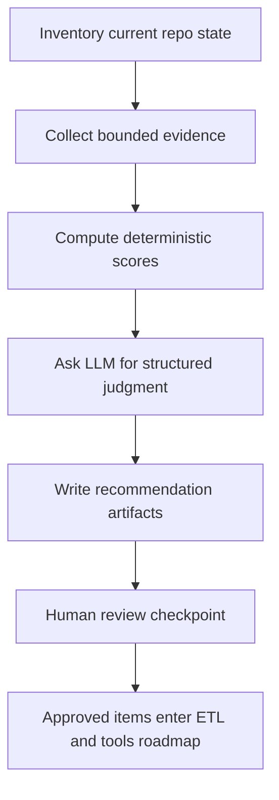

# Research Maintenance Capabilities Plan

## Goal
Define two conservative, human-reviewed maintenance capabilities for this repository:

1. `research-sources` to discover new or changed documentation and source candidates, evaluate whether they should be added or reweighted, and emit recommendations only
2. `research-tools` to reassess the usefulness and internal logic of the current tool surfaces and emit recommendations only

This plan is grounded in the current retrieval split implemented by [`retrieve()`](src/lib/retrieval.ts:174), [`runDeepResearch()`](src/lib/deep-research.ts:154), [`handleSearchDrupalDocs()`](src/tools/search-drupal-docs.ts:92), [`handleDeepResearchDrupal()`](src/tools/deep-research-drupal.ts:119), the ETL orchestration in [`main()`](etl/run.ts:25), and the fetch-script pattern in [`scripts/sync-docs.sh`](scripts/sync-docs.sh:1).

## Planning Guardrails
- Recommendations only
- No automatic source-weight changes
- No automatic tool-logic changes
- No automatic ETL activation for newly found sources
- Every proposed change must pass explicit human review before work moves into implementation plans

## Why These Capabilities Fit This Repo
The repository already has three relevant architectural traits:

- shared retrieval policy in [`src/lib/retrieval.ts`](src/lib/retrieval.ts:174)
- iterative planning behavior in [`src/lib/deep-research.ts`](src/lib/deep-research.ts:154)
- source-specific fetch and parse stages under [`scripts/`](scripts/) and [`etl/`](etl/)

That means this repo already has the right seams for maintenance research to produce useful output without directly modifying runtime behavior. The new capabilities should therefore sit one layer above implementation and emit artifacts that humans can review and then translate into ETL or tool-roadmap work.

## Proposed Capability Shapes

### `research-sources`
Primary question: which external documentation or code sources now exist, have changed materially, or have become more or less valuable for retrieval than the current corpus listed in [`README.md`](README.md:151)?

Desired outputs:
- add candidate recommendations
- do not add recommendations
- reweight up recommendations
- reweight down recommendations
- watchlist recommendations
- ETL follow-up recommendations
- benchmark ideas for validating the recommendation

### `research-tools`
Primary question: are the current tool boundaries, prompts, heuristics, and retrieval policies still helpful given the present corpus, benchmark needs, and agent use cases?

Desired outputs:
- keep as-is recommendations
- tighten contract recommendations
- simplify logic recommendations
- add observability recommendations
- retire or merge surface recommendations
- prompt update recommendations
- benchmark additions for proving usefulness changes

## Shared Operating Model

### Evidence-first principle
Both capabilities should use deterministic evidence collection first, then optional LLM judgment, then human review.

### Conservative review flow
1. collect local repo evidence
2. collect bounded external evidence when applicable
3. score and summarize candidates
4. produce structured recommendation artifacts
5. require human review checkpoint
6. only after review, convert approved recommendations into new implementation tasks or active plans

### Shared artifact model
Recommended future runtime artifacts:

- `data/cache/research-sources/discovery.json`
- `data/cache/research-sources/evaluation.json`
- `data/cache/research-sources/recommendations.md`
- `data/cache/research-tools/inventory.json`
- `data/cache/research-tools/evaluation.json`
- `data/cache/research-tools/recommendations.md`

These should be treated as ephemeral working artifacts, while approval-ready conclusions should be promoted into plan documents under [`plans/active/`](plans/active/).

## Architecture Overview



## Capability 1 Design: `research-sources`

### Repository context it should read
- current source inventory and narrative in [`README.md`](README.md:151)
- ETL orchestration in [`etl/run.ts`](etl/run.ts:89)
- parser coverage under [`etl/`](etl/)
- fetcher coverage under [`scripts/`](scripts/)
- retrieval tiers, ordering, and heuristic boosts in [`src/lib/retrieval.ts`](src/lib/retrieval.ts:67)
- current roadmap gaps in [`plans/active/roadmap-phased-milestones.md`](plans/active/roadmap-phased-milestones.md:38)
- active source-quality work in [`plans/active/tutorials-and-examples-implementation-plan.md`](plans/active/tutorials-and-examples-implementation-plan.md:35)

### Script form
Recommended future entry point: `scripts/research-sources.ts`

#### Script execution model
- run on demand by a maintainer
- optionally run in a low-frequency scheduled job outside the repo
- read local manifests and plans first
- perform bounded web research against preapproved domains
- write structured recommendation artifacts
- exit without changing repo code, ETL config, or retrieval weights

#### Script pipeline stages
1. **Inventory current corpus**
   - derive known datasets from [`README.md`](README.md:151), [`etl/run.ts`](etl/run.ts:129), and current parser and fetch script names under [`etl/`](etl/) and [`scripts/`](scripts/)
   - normalize into a source registry with fields such as source id, domain, fetch method, parser status, dataset name, current tier, and known gaps
2. **Detect potential changes**
   - compare the known registry to current documentation hubs, feeds, project indexes, changelogs, and curated source pages
   - detect candidates that are new, moved, significantly updated, or degraded
3. **Candidate triage**
   - reject low-authority or duplicate candidates early
   - group candidates into canonical source families such as official docs, code repositories, change records, best-practice guides, or tutorial material
4. **Structured evaluation**
   - compute deterministic scores
   - optionally ask an LLM to interpret ambiguous tradeoffs
5. **Recommendation output**
   - emit structured JSON and a review-ready Markdown brief
6. **Roadmap handoff**
   - map approved items to ETL, retrieval, tests, or plan work rather than modifying those surfaces directly

#### Source evaluation criteria
- authority of publisher
- Drupal relevance and specificity
- freshness and update cadence
- expected retrieval value
- likely novelty versus existing datasets
- parseability and fetch stability
- licensing and access constraints
- maintenance burden
- benchmark coverage potential
- risk of noise, duplication, or drift

#### Source-weighting heuristics
Recommendations should be based on a weighted rubric, not one-off intuition:

- **Authority weight**: official Drupal and official upstream references score highest
- **Implementation proximity**: runnable code and canonical API references score above narrative tutorials
- **Freshness weight**: recently updated, versioned material scores higher if it aligns with the supported Drupal branch
- **Novelty weight**: sources that fill gaps not already covered by [`README.md`](README.md:153) score higher
- **Redundancy penalty**: sources with heavy overlap against existing high-quality corpora score lower
- **Retrieval fit weight**: sources whose structure is likely to chunk cleanly and retrieve well score higher
- **Maintenance penalty**: fragile scraping, access restrictions, or unstable URLs reduce priority
- **Benchmark-lift weight**: sources likely to improve unanswered benchmark questions score higher

#### Script inputs
- current plan docs under [`plans/active/`](plans/active/) and [`plans/archived/`](plans/archived/)
- corpus inventory from [`README.md`](README.md:151)
- fetch and ETL coverage from [`scripts/`](scripts/) and [`etl/`](etl/)
- optional seed list of allowed domains
- optional cache snapshots from prior runs

#### Script outputs
- machine-readable candidate registry
- machine-readable evaluation scores
- Markdown recommendation report with sections for add, reweight, reject, and watch
- optional benchmark proposal list for validating impact

#### Web research strategy for script form
- use a curated allowlist of domains first
- prefer official documentation indexes, release notes, changelogs, handbook landing pages, and project repository documentation over broad web search
- follow only bounded link depth
- cache fetched metadata and summaries
- avoid scraping deep page bodies unless the candidate passes initial authority checks

#### LLM usage in script form
Use LLM judgment only after deterministic filtering. Good uses:

- classify a source into repository-relevant categories
- summarize why a candidate is additive or redundant
- convert evidence into recommendation prose
- compare ambiguous candidates that have similar deterministic scores

Avoid using the LLM to discover sources from scratch without deterministic guardrails.

### Skill or reusable agent pattern form
Recommended future pattern name: `research-sources-skill`

#### Best use case
- ad hoc reassessment by coding agents before starting ETL expansion work
- a planner pattern for evaluating one source family or one domain subset at a time
- a reusable procedure that RooCode or Claude Code can invoke during architecture work

#### Skill execution model
- agent loads repo context from [`README.md`](README.md:151), [`etl/run.ts`](etl/run.ts:89), and active plans
- agent is given a bounded domain list or candidate list
- agent performs web research under explicit domain restrictions
- agent emits a structured recommendation document and no code changes

#### Skill contract
Suggested input contract:

```json
{
  "goal": "reassess documentation source coverage",
  "current_sources": [],
  "allowed_domains": [],
  "focus_area": "official docs | contrib docs | examples | adjacent upstream docs",
  "review_posture": "conservative",
  "required_output": {
    "add": [],
    "reweight_up": [],
    "reweight_down": [],
    "watchlist": [],
    "rejections": [],
    "followup_tasks": []
  }
}
```

Suggested output contract:

```json
{
  "summary": "",
  "inventory_gaps": [],
  "recommendations": [],
  "review_questions": [],
  "etl_followups": [],
  "retrieval_followups": [],
  "benchmark_followups": []
}
```

#### Skill strengths
- flexible and cheap to adapt to one-off questions
- strong at comparative reasoning across plans, code, and fetched evidence
- useful during planning sessions before maintainers commit to ETL work

#### Skill weaknesses
- less repeatable than a script
- weaker caching and audit trail unless the host agent deliberately persists artifacts
- more likely to vary between runs

### Recommendation for `research-sources`
Best outcome: **hybrid with script-primary design**

Reasoning:
- this capability needs repeatable inventory, caching, and evidence snapshots
- the repo already organizes source work through fetch and ETL stages in [`scripts/`](scripts/) and [`etl/`](etl/)
- maintainers will benefit from a stable report that can be compared across runs
- the skill remains valuable as a planner and reviewer for narrow source families, but should not be the system of record

## Capability 2 Design: `research-tools`

### Repository context it should read
- tool contracts in [`src/tools/search-drupal-docs.ts`](src/tools/search-drupal-docs.ts:43) and [`src/tools/deep-research-drupal.ts`](src/tools/deep-research-drupal.ts:56)
- shared retrieval policy in [`src/lib/retrieval.ts`](src/lib/retrieval.ts:174)
- planner prompts and iteration flow in [`src/lib/deep-research.ts`](src/lib/deep-research.ts:404)
- roadmap and quality goals in [`plans/active/roadmap-phased-milestones.md`](plans/active/roadmap-phased-milestones.md:74) and [`plans/active/skill-rag-integration-plan.md`](plans/active/skill-rag-integration-plan.md:34)
- benchmark and test files under [`tests/`](tests/)

### Script form
Recommended future entry point: `scripts/research-tools.ts`

#### Script execution model
- collect tool inventory from [`src/tools/`](src/tools/)
- extract static contracts, input schemas, and output shapes
- inspect retrieval heuristics in [`buildDatasetRequests()`](src/lib/retrieval.ts:305)
- inspect planner prompts in [`callInitialPlanner()`](src/lib/deep-research.ts:404), [`callIterationPlanner()`](src/lib/deep-research.ts:443), and [`callDossierPlanner()`](src/lib/deep-research.ts:468)
- optionally run or consume benchmark outputs from [`tests/`](tests/)
- emit recommendations without modifying logic

#### Script pipeline stages
1. **Tool inventory**
   - list current tools and their stated job to be done
   - map each tool to the shared layers it depends on
2. **Contract extraction**
   - collect tool names, schemas, defaults, bounds, and output formats
3. **Overlap analysis**
   - detect duplicated responsibilities or ambiguous boundaries between raw retrieval, human synthesis, skill guidance, and deep research
4. **Heuristic review**
   - inspect query classification and dataset boost logic such as [`classifyQuery()`](src/lib/retrieval.ts:258) and [`buildDatasetRequests()`](src/lib/retrieval.ts:305)
5. **Prompt review**
   - inspect prompt goals, evidence usage rules, and JSON contract strictness in [`src/lib/deep-research.ts`](src/lib/deep-research.ts:404)
6. **Benchmark alignment review**
   - compare tools against test coverage and open roadmap objectives
7. **Recommendation output**
   - emit structured keep, simplify, tighten, observe, or extend recommendations

#### Tool-usefulness heuristics
- **Clear user or agent job**: each tool should have a distinct reason to exist
- **Boundary clarity**: minimal ambiguity between raw search, synthesis, skill guidance, and planning
- **Evidence leverage**: the tool should use corpus assets that other tools cannot substitute for cleanly
- **Contract stability**: predictable input and output schema
- **Prompt boundedness**: instructions should remain auditable and not sprawl
- **Benchmark contribution**: the tool should improve measurable tasks or coverage
- **Observability**: logs or metrics should make regressions diagnosable
- **Cost and latency proportionality**: heavier reasoning should justify itself
- **Maintenance cost**: heuristics and prompt layers should not become brittle faster than they add value

#### Tool update recommendation categories
- keep current behavior
- simplify defaults or bounds
- clarify schema or output formatting
- improve logging and metrics
- change retrieval heuristics
- change prompt contracts
- add benchmark coverage
- consider merge or retirement

#### Script inputs
- tool files in [`src/tools/`](src/tools/)
- retrieval and planner logic in [`src/lib/retrieval.ts`](src/lib/retrieval.ts:174) and [`src/lib/deep-research.ts`](src/lib/deep-research.ts:154)
- active plans under [`plans/active/`](plans/active/)
- benchmark definitions under [`tests/`](tests/)
- optional recorded tool traces or metrics logs

#### Script outputs
- tool inventory report
- overlap matrix
- heuristic audit
- prompt audit
- benchmark gap list
- recommendation report ordered by confidence and expected usefulness

#### LLM usage in script form
Useful for:
- interpreting whether a prompt contract is too broad or too narrow
- summarizing where tool boundaries are confusing
- proposing benchmark questions that expose overlap or drift

Less suitable for:
- replacing deterministic schema and dependency extraction
- making unsupported judgments without benchmark evidence

### Skill or reusable agent pattern form
Recommended future pattern name: `research-tools-skill`

#### Best use case
- planning sessions where an agent must decide whether an existing tool should be used, extended, or left unchanged
- periodic architectural audits before implementing new tool features
- reviewing one tool surface in depth with repo context and benchmark context

#### Skill execution model
- load the relevant tool file, retrieval logic, deep-research prompts, active plans, and benchmark files
- produce a structured architecture review
- stay recommendation-only

#### Skill contract
Suggested input contract:

```json
{
  "goal": "reassess current tool usefulness",
  "target_tools": [],
  "repo_context": [],
  "benchmark_context": [],
  "review_posture": "conservative",
  "required_output": {
    "keep": [],
    "tighten": [],
    "simplify": [],
    "observe": [],
    "benchmark_additions": []
  }
}
```

Suggested output contract:

```json
{
  "summary": "",
  "tool_assessments": [],
  "cross_tool_findings": [],
  "heuristic_findings": [],
  "prompt_findings": [],
  "recommendations": [],
  "review_questions": []
}
```

#### Skill strengths
- strongest form for qualitative architectural reasoning
- naturally fits coding-agent workflows where a human asks for a reassessment before implementation
- good at connecting roadmap goals, prompt design, and tool boundaries in one pass

#### Skill weaknesses
- repeatability depends on the host agent and prompt discipline
- harder to audit over time unless outputs are persisted to Markdown artifacts

### Recommendation for `research-tools`
Best outcome: **hybrid with skill-primary design**

Reasoning:
- the most valuable part of this capability is architectural interpretation, not web crawling
- the repository already has a strong code-first separation of concerns that agents can reason over directly through [`src/tools/`](src/tools/), [`src/lib/retrieval.ts`](src/lib/retrieval.ts:174), and [`src/lib/deep-research.ts`](src/lib/deep-research.ts:154)
- a lightweight script is still useful for deterministic evidence collection, schema extraction, and benchmark collation
- the skill should be the preferred interface for maintainers because it can explain tradeoffs in context

## Script versus Skill Comparison

| Dimension | `research-sources` script | `research-sources` skill | `research-tools` script | `research-tools` skill |
|---|---|---|---|---|
| Primary value | repeatable discovery and scoring | flexible candidate review | deterministic inventory and audits | high-context architectural reasoning |
| Best execution style | batch and cached | ad hoc and task-scoped | periodic audit batch | planning-time review |
| Dependencies | web fetch, cache, registry, scoring | agent web search and repo reads | static analysis, benchmark inputs | repo reads and structured prompts |
| LLM role | secondary triage and prose | primary comparative reasoning | secondary interpretation | primary synthesis and recommendation |
| Auditability | high | medium | high | medium |
| Repeatability | high | medium | high | medium |
| Best for conservative review | strong | acceptable with saved outputs | strong | strong if outputs are persisted |
| Recommended shape | hybrid, script-primary | supporting mode | hybrid, evidence collector | hybrid, skill-primary |

## Safety and Review Flow

### Checkpoints for `research-sources`
1. approve domain allowlist before web discovery
2. review shortlist before any ETL implementation plan is created
3. review source-weight recommendations before any retrieval tuning plan is created
4. require benchmark design before promoting a candidate into roadmap work

### Checkpoints for `research-tools`
1. review the tool inventory and overlap map
2. review any claim that a tool should be merged, retired, or narrowed
3. require benchmark or trace evidence before changing heuristics in [`src/lib/retrieval.ts`](src/lib/retrieval.ts:174)
4. require prompt-contract review before touching planner prompts in [`src/lib/deep-research.ts`](src/lib/deep-research.ts:404)

## Caching and Logging

### `research-sources`
- cache fetched page metadata, candidate summaries, and domain discovery state under `data/cache/research-sources/`
- log when a candidate first appears, disappears, changes URL, or changes update cadence
- persist source scoring inputs so human reviewers can see why a recommendation changed

### `research-tools`
- cache tool inventories, extracted schemas, prompt snapshots, and benchmark digests under `data/cache/research-tools/`
- log when a tool contract changes, when heuristics change, and when benchmark expectations drift
- snapshot prompt text hashes for [`callInitialPlanner()`](src/lib/deep-research.ts:404), [`callIterationPlanner()`](src/lib/deep-research.ts:443), and [`callDossierPlanner()`](src/lib/deep-research.ts:468)

## How Recommendations Feed Back Into the Repo Roadmap

### From `research-sources`
Approved recommendations should flow into:
- new or revised fetch scripts under [`scripts/`](scripts/)
- new or revised parsers under [`etl/`](etl/)
- retrieval weighting proposals for [`src/lib/retrieval.ts`](src/lib/retrieval.ts:67)
- benchmark additions under [`tests/`](tests/)
- updated roadmap entries in [`plans/active/roadmap-phased-milestones.md`](plans/active/roadmap-phased-milestones.md:36)

### From `research-tools`
Approved recommendations should flow into:
- tool contract updates in [`src/tools/`](src/tools/)
- shared heuristic changes in [`buildDatasetRequests()`](src/lib/retrieval.ts:305)
- prompt and dossier-contract changes in [`src/lib/deep-research.ts`](src/lib/deep-research.ts:404)
- benchmark and observability work in [`tests/`](tests/) and future logging plans
- active plan updates where recommendations become implementation work

## Practical Sequencing Recommendation
1. implement `research-sources` as the first maintenance capability because source expansion and weighting directly affect every current tool
2. implement `research-tools` next with a hybrid design that consumes the same benchmark and roadmap context
3. keep both recommendation-only until the review loop has demonstrated stable usefulness

## Final Recommendations
- `research-sources`: build as **hybrid with script-primary design**
- `research-tools`: build as **hybrid with skill-primary design**
- keep both capabilities recommendation-only and human-reviewed
- use structured artifacts and plan handoff rather than automatic repo mutation

## Suggested Next Implementation Plans
If these capabilities are approved later, split implementation planning into two follow-on plans:

1. `research-sources-implementation-plan.md`
2. `research-tools-implementation-plan.md`

Each should include schema details, cache layout, benchmark hooks, and explicit reviewer signoff steps before any runtime behavior changes.
