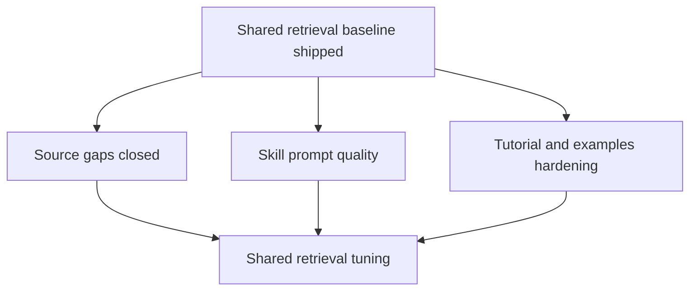

# Phased Roadmap — Drupal Architect MCP Server

## Goal
Track the remaining work after the main search-tool split shipped, with active phases aligned to the current layered architecture.

## Current Status
- [x] Discovery
- [x] Architecture split implemented
- [ ] Remaining quality and corpus work

## Implemented Architecture Baseline
- Shared retrieval policy is now centralised in [`src/lib/retrieval.ts`](src/lib/retrieval.ts:174)
- Raw evidence for AI coders is exposed by [`search_drupal_docs`](src/tools/search-drupal-docs.ts:43)
- Human-facing explanation remains in [`ask_drupal_expert`](src/tools/ask-drupal-expert.ts:180)
- Planning and advisory research run through [`runDeepResearch()`](src/lib/deep-research.ts:154) and [`deep_research_drupal`](src/tools/deep-research-drupal.ts:56)
- Skill guidance is separately available through [`drupal_skill_guide`](src/tools/drupal-skill-guide.ts:28)

## Active Phases

### Phase 1 — Finish source gaps that feed the shared retrieval layer
Focus on corpus gaps that improve all three retrieval consumers, not just one tool.

Next actions:
- Add ETL and verification for `contrib_module_handbook`
- Finish ETL and verification for `drupal_module_handbook`
- Validate that both sources are retrievable through [`src/lib/retrieval.ts`](src/lib/retrieval.ts:174) and visible to all tool surfaces

Exit criteria:
- Both datasets are fetched, parsed, loaded, and verified
- Queries for module creation and extension work surface those datasets in raw and synthesized flows

### Phase 2 — Finish skill-aware prompt quality work
Reference: [`plans/active/skill-rag-integration-plan.md`](plans/active/skill-rag-integration-plan.md)

Next actions:
- Tighten skill-domain detection quality in [`handleAskDrupalExpert()`](src/tools/ask-drupal-expert.ts:218)
- Add the deferred soft-intent fallback only if deterministic routing is insufficient
- Add validation coverage for skill injection and guard against prompt bloat

Exit criteria:
- Skill injection is reliable on benchmark questions
- Prompt assembly remains bounded and auditable

### Phase 3 — Harden tutorials and examples as shared retrieval assets
Reference: [`plans/active/tutorials-and-examples-implementation-plan.md`](plans/active/tutorials-and-examples-implementation-plan.md)

Next actions:
- Validate tutorial/example parsing and metadata quality
- Ensure tutorial assets improve raw search, synthesized answers, and deep research planning
- Add only the minimum metadata filters that materially improve retrieval quality

Exit criteria:
- `drupal_tutorials` chunks are trustworthy and discoverable across all tool surfaces
- Example-oriented questions consistently surface tutorial/example evidence

### Phase 4 — Retrieval quality and observability
Focus on shared improvements that benefit the full stack.

Next actions:
- Denoise noisy corpora before embedding
- Tune dataset-specific thresholds and ranking in [`src/lib/retrieval.ts`](src/lib/retrieval.ts:174)
- Expand benchmark coverage and query metrics for regression detection

Exit criteria:
- Retrieval quality improvements are measured against repeatable benchmark questions
- Logs and manual checks make ranking regressions visible

## Milestone Checklist
- [x] Shared retrieval extracted
- [x] Raw search tool implemented
- [x] Human explanatory tool aligned to shared retrieval
- [x] Deep research planner implemented
- [ ] Module handbook sources completed
- [ ] Skill-routing quality completed
- [ ] Tutorials/examples hardening completed
- [ ] Retrieval benchmarking and tuning completed

## Dependency View

## Key Decisions
- Keep active plans focused on unfinished work, not architecture already implemented
- Treat tutorials, examples, and new handbook sources as corpus improvements that should benefit every retrieval consumer
- Preserve a strict separation between raw retrieval output, human explanation, and advisory planning
