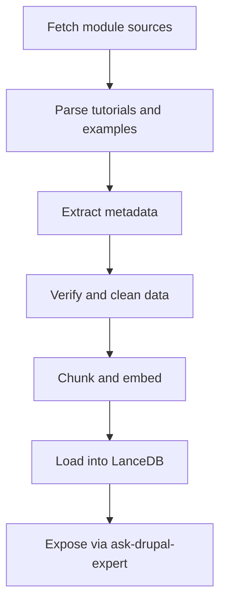

# Tutorials and Examples Integration Plan

## 1. Goal
The objective is to **enrich the knowledge base** with high-quality, real-world tutorials and examples from widely used Drupal community modules. These examples will help developers and site builders understand practical implementations of Drupal concepts, complementing the existing core documentation and developer guides.

## 2. Identify Top Community Modules
Focus on the most popular and educational Drupal modules that demonstrate best practices and common use cases:

| Module | Description | Repository |
|---------|--------------|-------------|
| **Views** | Build dynamic lists and queries of content. | https://www.drupal.org/project/views |
| **Webform** | Create complex forms and surveys. | https://www.drupal.org/project/webform |
| **Pathauto** | Automatically generate SEO-friendly URLs. | https://www.drupal.org/project/pathauto |
| **Paragraphs** | Flexible content components for editors. | https://www.drupal.org/project/paragraphs |
| **Token** | Provides placeholder tokens for dynamic text. | https://www.drupal.org/project/token |
| **Devel** | Developer tools for debugging and profiling. | https://www.drupal.org/project/devel |
| **Metatag** | Manage meta tags for SEO and social sharing. | https://www.drupal.org/project/metatag |
| **Redirect** | Manage URL redirects. | https://www.drupal.org/project/redirect |
| **Admin Toolbar** | Enhances the default admin menu. | https://www.drupal.org/project/admin_toolbar |
| **CKEditor 5** | Rich text editor integration. | https://www.drupal.org/project/ckeditor5 |

## 3. Data Sources
Tutorials and examples will be collected from multiple authoritative sources:

- **Drupal.org project pages** — official documentation, examples, and issue discussions.
- **GitLab repositories** — README files, `/examples` directories, and inline code comments.
- **Community guides** — curated tutorials from Drupal.org documentation and Planet Drupal blogs.
- **Module maintainers’ documentation** — external GitHub or GitLab repos linked from project pages.

## 4. Ingestion Strategy
A new ETL pipeline extension will be created to fetch, parse, and verify tutorials and examples.

### New ETL Components
- [`etl/parse-tutorials.ts`](etl/parse-tutorials.ts): Extracts tutorial content, code snippets, and metadata from module sources.
- [`etl/verify-tutorials.ts`](etl/verify-tutorials.ts): Validates extracted data for completeness, accuracy, and duplication.

### Workflow

### Steps
1. **Fetch**: Use `scripts/fetch-tutorials.sh` to download module READMEs and example directories.
2. **Parse**: Identify tutorial sections, code blocks, and usage examples.
3. **Verify**: Ensure examples are valid, non-duplicative, and properly attributed.
4. **Chunk & Embed**: Use existing `etl/chunker.ts` and `etl/embedder.ts` for semantic embedding.
5. **Load**: Store processed examples in LanceDB for retrieval.

## 5. Metadata Schema
Each tutorial or example will include structured metadata for discoverability and filtering.

| Field | Type | Description |
|--------|------|-------------|
| `id` | string | Unique identifier |
| `module` | string | Drupal module name |
| `title` | string | Tutorial or example title |
| `topic` | string | Key concept (e.g., Views filters, Webform submission) |
| `complexity` | enum(`beginner`, `intermediate`, `advanced`) | Difficulty level |
| `source_url` | string | Original source link |
| `content` | text | Full tutorial or example text |
| `code_snippets` | array | Extracted code examples |
| `tags` | array | Keywords for search and categorization |
| `last_updated` | date | Last modified date from source |

## 6. Integration Plan

### In `ask-drupal-expert`
- Extend [`src/tools/ask-drupal-expert.ts`](src/tools/ask-drupal-expert.ts) to query the new `tutorials` collection in LanceDB.
- Add filtering by `module`, `topic`, and `complexity`.
- Display example snippets inline with answers.

### In LanceDB
- Create a new table: `drupal_tutorials.lance`.
- Store embedded vectors for semantic search.
- Integrate with existing `etl/loader.ts` for unified ingestion.

## 7. Deliverables

| Type | File | Description |
|------|------|-------------|
| **Script** | `scripts/fetch-tutorials.sh` | Fetches module documentation and examples. |
| **ETL Parser** | `etl/parse-tutorials.ts` | Extracts and structures tutorial data. |
| **ETL Verifier** | `etl/verify-tutorials.ts` | Validates and cleans parsed data. |
| **Database** | `data/lancedb/drupal_tutorials.lance` | Stores embedded tutorial data. |
| **Tool Update** | `src/tools/ask-drupal-expert.ts` | Adds tutorial retrieval and display. |
| **Documentation** | `README.md` and `plans/tutorials-and-examples-implementation-plan.md` | Describes ingestion and integration process. |

## 8. Next Steps
1. Implement `fetch-tutorials.sh` to gather module data.
2. Develop `parse-tutorials.ts` and `verify-tutorials.ts`.
3. Extend ETL runner to include tutorials pipeline.
4. Update `ask-drupal-expert` to surface examples.
5. Test and validate integration end-to-end.